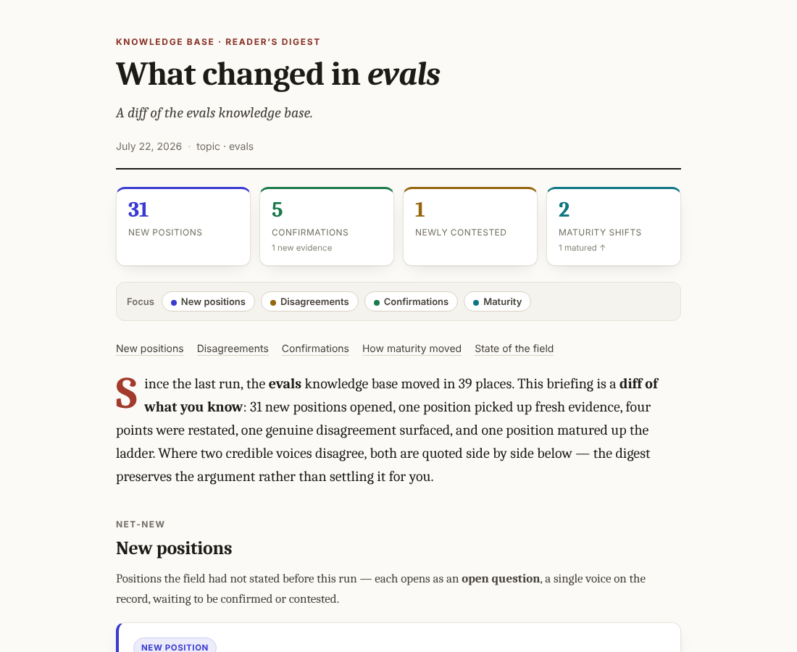

<h1 align="center">Knowledge-Base</h1>

<p align="center">A pipeline that turns hand-picked YouTube AI videos into a per-topic knowledge base and a digest of what changed since the last run.</p>

<p align="center">
  
</p>

<p align="center"><sub>The top of the HTML digest from the first real run on the evals topic (committed at <code>fixtures/digest-sample/2026-07-22-evals-first-real-run.html</code>). The counts are the diff of that run, not hand-set values.</sub></p>

## Why

Following AI videos leaves you with notes and no sense of which claims are contested and which have settled.
The pipeline extracts claims from each video, compares each one with the positions already on record for its topic, and keeps both stances, quoted with source and date, where videos disagree.
Each position carries a maturity flag (open, emerging, converging, solved) that is recomputed from the evidence on every run.

## Status

The first delivery is a vertical slice: all five layers, the single topic `evals`, and a seed list of 15 video URLs (`seed/evals.txt`).
The other five topic seed lists are in `seed/`; they have not been run through the slice.

## Pipeline

```
seed/evals.txt (URLs, manual)
      │  yt-dlp + youtube-transcript-api
   ingest ──► SQLite: videos
      │  Agent SDK · Sonnet
   extract units
      │  Agent SDK · Haiku, retried on Sonnet if output fails validation
   route to topics (multi-topic)
      │  stage 1: BGE-M3 embeddings (sentence-transformers) + LanceDB top-k
      │  stage 2: Agent SDK · Opus adjudicates
   reconcile ──► positions (flat JSON/MD per topic) + status history
      │  compute_maturity(position, config, now)
   render HTML digest ──► digests/YYYY-MM-DD-evals.html
```

Entry point for the whole slice: `python scripts/run_slice.py`.

## Documents

- [map.md](map.md): destination, scope and standing decisions.
- [spec.md](spec.md): the product requirements document.
- [research/integration-findings.md](research/integration-findings.md): findings behind the integration architecture.
- [docs/ingest.md](docs/ingest.md): the ingest layer.

## Tickets

| # | Title | Type | Blocked by |
|---|-------|------|------------|
| [01](tickets/01-storage-architecture.md) | Storage architecture for thousands of videos | research | none |
| [02](tickets/02-subscription-llm-execution.md) | Run automated LLM calls on the Claude subscription | research | none |
| [03](tickets/03-ingest-extract-glue.md) | Ingest + extract glue (Layer 1) | task | none |
| [04](tickets/04-unit-extraction-schema.md) | Unit extraction schema (Layer 2) | prototype | none |
| [05](tickets/05-seed-video-set.md) | Seed video set for the evals slice | task | none |
| [06](tickets/06-position-kb-data-model.md) | Position + per-topic KB data model (Layer 4) | prototype | 01, 04 |
| [07](tickets/07-topic-routing.md) | Topic routing (Layer 3) | prototype | 02, 04 |
| [08](tickets/08-reconciliation-engine.md) | Two-stage matcher + reconciliation engine (Layer 5) | prototype | 02, 06 |
| [09](tickets/09-maturity-state-machine.md) | Maturity state machine config | task | 06 |
| [10](tickets/10-html-digest-surface.md) | HTML digest output surface | prototype | 08 |
